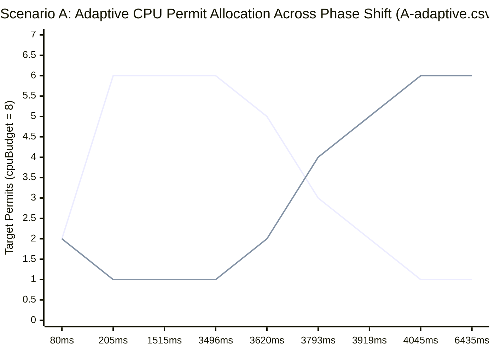

# EazyPipe 2.0 — Benchmarks & Proof of Value

This document reports reproducible **JMH microbenchmarks** and **end-to-end dynamic workload scenarios (A–E)** for EazyPipe 2.0's Gen-2 adaptive engine, executed on the standalone `eazypipe-benchmarks` project.

## Test Environment

- **CPU**: Intel Core i7-14700HX (20 physical cores / 28 logical processors)
- **OS**: Windows 11 Pro 64-bit
- **JDK**: OpenJDK 21.0.11+10-LTS (`java.base`-only core runtime, JPMS `xyz.scarabya.eazypipe`)
- **Benchmark harness**: JMH `1.37`, Project Reactor `3.7.0`

## How to Reproduce Locally

1. Install the core artifact into the local Maven repository:
   ```powershell
   .\mvnw.cmd -B install -DskipTests
   ```
   *(Linux / macOS: `./mvnw -B install -DskipTests`)*

2. Build the shaded benchmark JAR (keeps the core artifact zero-dependency):
   ```powershell
   .\mvnw.cmd -B -f eazypipe-benchmarks\pom.xml package
   ```

3. Run the JMH suite:
   ```powershell
   java -jar eazypipe-benchmarks\target\benchmarks.jar -f 1 -wi 2 -i 3 -w 2s -r 3s -to 1m
   ```

4. Run dynamic Scenarios A–E under tight heap (`-Xmx64m`) and export per-tick CSV traces to `eazypipe-benchmarks/target/scenarios/`:
   ```powershell
   java -Xmx64m -cp eazypipe-benchmarks\target\benchmarks.jar xyz.scarabya.eazypipe.bench.scenarios.ScenarioRunner all
   ```

---

## 1. JMH Microbenchmarks (Stationary Homogeneous Workloads)

Each operation executes a complete **10,000-item** two-stage pipeline (`Throughput`, `ops/s` = pipelines completed per second; derived `items/s = ops/s × 10,000`).

> **Java 21 Baseline Note**: `Gatherers.mapConcurrent(...)` requires Java 24+ and is omitted here.

| Benchmark | Workload | Score (ops/s) | ± 99.9% Error | Equivalent Throughput (items/s) |
| :--- | :--- | ---: | ---: | ---: |
| `IntStream.range(...).parallel()` | CPU (`1,500` tokens × 2) | **141.039** | ± 80.153 | ~1,410,390 items/s |
| `BlockingQueue` + Fixed Pool (manual) | CPU (`1,500` tokens × 2) | **22.554** | ± 19.175 | ~225,540 items/s |
| `EazyPipe` Static (`cpuBound`) | CPU (`1,500` tokens × 2) | **11.827** | ± 3.863 | ~118,270 items/s |
| `EazyPipe` Adaptive (Gen-2) | CPU (`1,500` tokens × 2) | **11.334** | ± 0.776 | ~113,340 items/s |
| `Project Reactor` (`Schedulers.parallel`) | CPU (`1,500` tokens × 2) | **7.967** | ± 1.577 | ~79,670 items/s |
| `Project Reactor` (`boundedElastic`, concurrency=64) | I/O (`Thread.sleep(1)` × 2) | **2.796** | ± 0.224 | ~27,960 items/s |
| `BlockingQueue` + Virtual Threads (manual) | I/O (`Thread.sleep(1)` × 2) | **0.448** | ± 0.078 | ~4,480 items/s |
| `EazyPipe` Static (`ioBound`, concurrency=64) | I/O (`Thread.sleep(1)` × 2) | **0.443** | ± 0.218 | ~4,430 items/s |
| `EazyPipe` Adaptive (`ioBound`, init=16..64) | I/O (`Thread.sleep(1)` × 2) | **0.078** | ± 0.605 | ~780 items/s |

### Microbenchmark Takeaways

- **CPU Pipelines (`EazyPipe` vs Reactive & Telemetry Cost)**: `EazyPipe` Static (`11.827 ops/s`) is **1.48× faster** than Project Reactor (`7.967 ops/s`), and enabling the Gen-2 adaptive engine (`11.334 ops/s`) adds only **~4.2%** overhead while remaining **1.42× faster** than Reactor.
- **Stateless `Stream.parallel()` & Manual Queues**: When pipelines do not need bounded inter-stage backpressure, retries/DLQ, batching, rate limiting, or mixed CPU/IO scheduling, raw `IntStream.parallel()` avoids channel handoffs entirely. Manual `BlockingQueue` + fixed pool avoids per-stage lock-free telemetry and dynamic permit checks, but shifts shutdown/poison-pill handling and pool-starvation avoidance onto the caller.
- **Stationary Windows I/O Sleep Behaviour**: Both pure virtual-thread implementations (`EazyPipe` Static `0.443 ops/s` and manual Virtual-Thread `BlockingQueue` `0.448 ops/s`) perform virtually identically (~2.25 s per 10k items on Windows), whereas Reactor runs on `Schedulers.boundedElastic()` platform threads (`2.796 ops/s`). Meanwhile, `EazyPipe` Adaptive starts at `initialConcurrency = 16` with `Balanced` `1s` cooldown across short 3 s iterations, so noisy Windows 1 ms sleep wakeups trigger conservative Vegas backoff (`0.041–0.105 ops/s`).

---

## 2. Dynamic Proof-of-Value Scenarios (A–E, `-Xmx64m`)

Static thread pools cannot adapt when payload cost shifts mid-stream, downstream endpoints stall, external APIs enforce concurrency limits with HTTP 429s, or `flatMap`/`batch` change stage multiplicity. Scenarios A–E test those regimes directly.

| Scenario | Mode | Items | Elapsed (ms) | Throughput (items/s) | p50 (ms) | p95 (ms) | p99 (ms) | Final Concurrencies | Decisions | Extra / Outcome |
| :--- | :--- | ---: | ---: | ---: | ---: | ---: | ---: | :--- | ---: | :--- |
| **A (Shifting CPU)** | `static-naive` (`2,2,2`) | 16,000 | 20,394 | 784.5 | 46.75 | 132.53 | 132.84 | — | 0 | `cpuBudget=8` |
| **A (Shifting CPU)** | `static-balanced` (`4,4,4`) | 16,000 | 10,181 | 1,571.6 | 25.67 | 71.15 | 71.37 | — | 0 | `cpuBudget=8` |
| **A (Shifting CPU)** | `adaptive` (`1..8`) | 16,000 | **7,105** | **2,251.9** | 42.94 | **45.60** | 104.90 | `cpu-1=1, cpu-2=1, cpu-3=6, sink=1` | 11 | **2.87×** vs naive, **1.43×** vs balanced |
| **B (Downstream Stall)** | `static-naive` (`buf=512`) | 1,200 | 11,771 | 101.9 | 4,200.11 | 10,920.81 | 11,502.65 | — | 0 | `peakHeap=27.4MB brakes=0` |
| **B (Downstream Stall)** | `adaptive` (`buf=32`) | 1,200 | **7,950** | **150.9** | **611.47** | **1,320.01** | **1,356.99** | `io-1=1, io-2=1, io-sink=4` | 24 | **8.3× lower p95**, `peakHeap=11.8MB` (**2.3×**), `brakes=6` |
| **C (IO Knee K=16)** | `static-naive` (`c=48`) | 5,270 | 12,656 | 416.4 | 217.32 | 327.71 | 350.79 | — | 0 | `429s=7784 dlq=730` |
| **C (IO Knee K=16)** | `static-oracle` (`c=16`) | 6,000 | 2,775 | 2,162.2 | 30.46 | 79.88 | 81.08 | — | 0 | `429s=0 dlq=0` (ideal static) |
| **C (IO Knee K=16)** | `adaptive` (`1..48`, init 4) | 6,000 | **4,804** | **1,249.0** | 43.50 | 132.92 | 220.16 | `ext-api=10` | 20 | **3.0×** vs naive, **`429s=0 dlq=0`** |
| **D (AI/RAG Fan-Out)** | `static-naive` (`8/2/1`) | 9,600 | 32,679 | 293.8 | 5,969.09 | 6,185.26 | 6,313.65 | — | 0 | `1,200 docs -> 8× chunks` |
| **D (AI/RAG Fan-Out)** | `static-oracle` (`1/24/4`) | 9,600 | 3,426 | 2,802.1 | 539.90 | 790.66 | 816.98 | — | 0 | `1,200 docs -> 8× chunks` |
| **D (AI/RAG Fan-Out)** | `adaptive` (`1/2/1` init) | 9,600 | **6,972** | **1,376.9** | 1,059.87 | 2,071.68 | 2,089.86 | `cpu-parse=1, io-embed=11, vector-db=1` | 27 | **4.7×** vs naive (fan-out aware) |
| **E (Soak & Chaos)** | `adaptive` (`-Xmx64m`) | 4,999,000 | 8,802 | **567,939.1** | — | — | — | `soak-cpu=28, soak-io=6, sink=1` | 17 | **PASS** `peakHeap=15.2MB thr=36->36 eazypipeAlive=0` |
| **E (Graceful Drain)** | `adaptive` | 183,880 | 151 | **1,217,748.3** | — | — | — | — | 0 | **PASS** (`produced == consumed`) |

### Scenario A Trajectory: Real-Time CPU Rebalancing Across Mid-Run Phase Shift

In Scenario A, `cpu-1` dominates the first 8,000 items (2.5 ms busy spin), then at half-run (`t = 3496 ms` in `A-adaptive.csv`) the load flips to `cpu-3`. Within **~550 ms** (`3496 ms → 4045 ms`), `CpuBudgetAllocator` transfers permits from `cpu-1` (`6 → 5 → 3 → 2 → 1`) directly to `cpu-3` (`1 → 2 → 4 → 5 → 6`), holding throughput near ~2,370 items/s under the same `cpuBudget=8`.



### Scenario Highlights

- **Scenario B (`Downstream Stall` under `-Xmx64m`)**: When `io-sink` latency jumps 20× after 30% of items, one-tick downstream propagation brakes fire **6 times** (`brakes=6`), throttling `io-1` and `io-2` from `8/8` down to `1/1`. Queue residency collapses, cutting p95 end-to-end latency by **8.3×** (`10,920.81 ms → 1,320.01 ms`) and peak heap by **2.3×** (`27.4 MB → 11.8 MB`).
- **Scenario C (`External I/O Knee K=16`)**: Over-provisioning concurrency (`48`) drives `7,784` HTTP `429` errors and drops `730` items into the dead-letter handler. Starting conservatively from `4`, adaptive mode delivers **3.0×** the throughput of naive static sizing with **0 retries** and **0 DLQ losses**.
- **Scenario D (`AI/RAG Ingestion`)**: `TopologyAnalyzer` measures the `~8×` chunk expansion across `flatMap` + `32×` compression across `batch(32)` and shifts resources from `cpu-parse=1` to `io-embed=11`, beating naive static sizing by **4.7×**.
- **Scenario E (`Soak & Chaos`)**: Processes **4,999,000 items** (skipping 1,000 injected fatal errors + retrying transient errors) inside **`-Xmx64m`** with **`15.2 MB` peak heap**, zero thread leak (`36 → 36`, `eazypipeAlive=0`), and zero lost items during mid-run `exec.drain()`.

---

## 3. Honest Trade-Offs & Limitations

- **Short-Run AIMD Ramp-Up Lag vs Ideal Oracle (Scenarios C & D)**: Because `IoConcurrencyLimiter` climbs additively (`+1` permit per eligible window after `persistenceTicks` + `cooldown`), starting from low initial concurrency (`4` in C, `2`/`4` in D) leaves adaptive throughput below a hand-tuned oracle (`1,249 vs 2,162 items/s` in C; `1,377 vs 2,802 items/s` in D) on short 3–7 second bursts. That exceeds the `<= 5%` steady-state overhead target during short ramp-up phases, trading peak burst speed for safety (0 HTTP 429s, 0 DLQ drops) until steady state or when higher initial concurrency hints are supplied.
- **Overhead vs Raw `Stream.parallel()` on Pure Compute**: When stages have uniform CPU cost, zero I/O blocking, and no need for bounded queues, retries, batching, or fault isolation, inter-stage channels and EMA telemetry add overhead relative to `IntStream.parallel()`.
- **Uniform Stationary I/O Sleep Workloads**: For completely stationary fixed-sleep loops without capacity limits or stalls, static concurrency on `StageConfig` avoids adaptive ramp-up and timer-jitter backoff.
