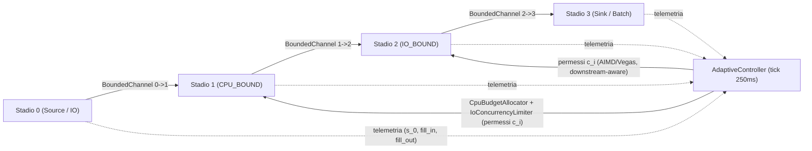

# EazyPipe 2.0 — Piano Architetturale e Roadmap di Implementazione

> **Obiettivo**: Evolvere **EazyPipe 2.0.0-SNAPSHOT** — già migrata da Java 1.5 alla nuova baseline Java 21 LTS (commit `bcbc8d2`) con Virtual Threads, API fluente type-safe e backpressure bounded — in un **motore di pipeline concorrenti adattive** a zero dipendenze nel core, con allocazione dinamica globale delle risorse anti-*bottleneck-shifting*.

---

## 0. Stato Attuale della Codebase (Baseline `bcbc8d2`)

La migrazione dalla v1.x (commit `2f711d9`, Java 1.5, reflection su stringhe) alla **v2.0.0-SNAPSHOT** è stata completata su `feat/eazypipe-v2-java21` e mergiata in `master` (`bcbc8d2`):

- **Build & Tooling pronti**: [pom.xml](../pom.xml) configurato per Java 21 (`<maven.compiler.release>21</maven.compiler.release>`, `-Xlint:all -Werror`), zero dipendenze runtime, **Maven Wrapper 3.3.4** ([mvnw](../mvnw) / [mvnw.cmd](../mvnw.cmd) con Maven `3.9.16`), workflow GitHub Actions ([ci.yml](../.github/workflows/ci.yml)) su `ubuntu-latest` e `windows-latest`, [README.md](../README.md) aggiornato.
- **Motore v2.0 base funzionante e testato**: 17 classi nel package `xyz.scarabya.eazypipe` e **25 test JUnit 5** (`5.14.4`) verdi in 4 suite (`BoundedChannelTest`, `EazyPipeCoreTest`, `EazyPipeConcurrencyTest`, `EazyPipeErrorHandlingTest`).

### Allineamento Nomi e Gap rispetto alla Bozza Iniziale

| Concetto nella bozza iniziale | Stato attuale (`bcbc8d2`) | Delta da implementare (M1b – M4) |
| :--- | :--- | :--- |
| `Pipeline.from` / `PipelineBuilder` | **`EazyPipe`** (`from`, `fromIterable`, `fromStream`, `of`) + **`Pipeline<T>`** immutabile | Aggiungere nuovi operatori su `Pipeline<T>` (`batch`, `retry`, `mapConcurrentOrdered`, mini-DAG) |
| `StageSpec` | **`StageConfig`** (`name`, `parallelism`, `bufferCapacity`, `onComplete` + `Builder`) | Estendere con `StageKind` (`CPU_BOUND` / `IO_BOUND`), bounds `min/maxConcurrency`, `OverflowPolicy`, `ErrorPolicy`, `RetrySpec`, `DeadLetterHandler` |
| `PipeConfig` *(nuovo rispetto alla bozza)* | **`PipeConfig`** (`defaultBufferCapacity=1024`, `ExecutorMode`, `customExecutor`, `ErrorStrategy`, `errorHandler`) | Integrare `AdaptiveConfig` (`tickInterval`, `cpuBudget`, `onDecision`, modalità disabilitata/statica) |
| `PipelineExecution<OUT>` | **`PipeExecution<R>`** (`AutoCloseable`, `future()`, `await()`, `await(Duration)`, `join()`, `cancel()`, `stats()`) | Distinguere chiusura *graceful drain* (`close()` / `drain()`) vs interruzione immediata (`cancel()`) |
| `BoundedChannel<T>` | **`BoundedChannel<T>`** (`ReentrantLock` + `Condition`, zero pinning, drain su `close()`, `abort()`) | Aggiungere `OverflowPolicy` (`BLOCK`, `DROP_OLDEST`, `DROP_NEWEST`, `FAIL`) e metriche `size()` / `fillRatio()` |
| `StageRunner` + `StageScheduler` + `DynamicPermitPool` | **`PipelineRuntime<R>`** (worker fissi per stadio, `AtomicInteger` per `onComplete` sicuro, `ExecutorMode` globale) | Estrarre `StageScheduler` ibrido CPU/IO e introdurre `DynamicPermitPool` per concorrenza elastica |
| `AdaptiveController`, `StageTelemetry`, `metrics` | *Non ancora implementati* | Implementazione completa in `xyz.scarabya.eazypipe.adaptive` e `xyz.scarabya.eazypipe.metrics` |

---

## 1. Visione, Contesto e Posizionamento di Mercato

### L'eredità storica di EazyPipe
Nel repository storico v1 (commit `5bfa15e`, prima del refactoring `93a5b4a` del 2019), EazyPipe conteneva già un embrione di questa idea: `ThreadPipeManager` osservava la dimensione delle code tra gli stadi per spostare dinamicamente thread verso gli stadi più carichi. Quel tentativo fallì e fu rimosso perché:
- avviava e fermava thread fisici continuamente (overhead alto e race condition);
- campionava le code su finestre di 1 microsecondo senza filtri né isteresi (*thrashing* / ping-pong);
- non distingueva carichi CPU-bound da I/O-bound e ignorava la saturazione degli stadi a valle (*bottleneck shifting*).

La **baseline 2.0 (`bcbc8d2`)** ha già costruito le fondamenta moderne (Java 21, Virtual Threads, API imperativa type-safe, backpressure su `BoundedChannel`). I passi successivi del piano completano l'intuizione originaria fondandola su controllo adattivo end-to-end e teoria delle code.

### Posizionamento rispetto all'ecosistema Java attuale
| Soluzione | Punto di forza | Cosa manca rispetto a EazyPipe 2.0 (target completo) |
| :--- | :--- | :--- |
| `Stream.parallel()` / `Gatherers` | Zero setup per trasformazioni semplici | Nessuna topologia multi-stadio eterogenea, `ForkJoinPool` globale, nessuna backpressure/DLQ/autoscaling. |
| `StructuredTaskScope` (Java 21+) | Ottimo per fan-out / fork-join | Pensato per task finiti, non per **streaming continuo multi-stadio** con code intermedie. |
| `BlockingQueue` + `Thread` manuali | Controllo totale | Boilerplate elevato, facile introdurre deadlock, chiusura difettosa multi-worker e assenza di bilanciamento. |
| `Project Reactor` / `RxJava` | Backpressure reattiva matura | Curva ripida, stack trace complessi, modello non imperativo e parallelismo **statico**. |
| `Netflix concurrency-limits` | Concorrenza adattiva AIMD/Vegas | Protegge un singolo endpoint/servizio, non bilancia una **pipeline end-to-end** tra più stadi interdipendenti. |

**Pitch di posizionamento**: *"La libreria di pipeline concorrenti per l'era dei Virtual Threads: codice imperativo bloccante, backpressure automatica e auto-bilanciamento end-to-end senza complessità reactive."*

---

## 2. Principi Architetturali e Requisiti Non Funzionali

1. **Java 21 LTS (`release=21`) e JPMS**:
   - ✅ Java 21, Virtual Threads (`Thread.ofVirtual()`), `record`, `sealed interface`, `AutoCloseable` già adottati.
   - ⏳ Aggiunta di `module-info.java` esplicito quando verrà consolidata la struttura dei package pubblici.
2. **Core a zero dipendenze**:
   - ✅ `EazyPipe` (`pom.xml`) non ha dipendenze runtime (solo JUnit 5 in `test`).
   - ⏳ Eventuali integrazioni esterne (Micrometer, JMH) saranno isolate in moduli Maven separati in M4.
3. **100% Type-Safe**:
   - ✅ Eliminata completamente la reflection basata su stringhe (`Pipeable(obj, "method")`) e i raw types; DSL basata su `@FunctionalInterface` (`PipeSource`, `PipeProcessor`, `PipeSink`, `PipeEmitter`, `PipeFunction`, `PipePredicate`), lambda e method reference.
4. **Separazione Definizione / Esecuzione**:
   - ✅ `Pipeline<T>` è **immutabile** e riutilizzabile come blueprint per più esecuzioni o ramificazioni.
   - ✅ `PipeExecution<R>` rappresenta una singola esecuzione attiva, implementa `AutoCloseable` ed espone `CompletableFuture<R>`, `await()`, `join()`, `cancel()`, `stats()`.
   - ⏳ Estendere `PipeExecution<R>` distinguendo esplicitamente *graceful drain* (`drain()`) vs *abort immediato* (`cancel()`).
5. **Concorrenza elastica tramite *permessi dinamici*** *(M1b–M2)*: invece di creare/uccidere thread o worker nel loop di controllo, la concorrenza effettiva di uno stadio viene governata da un budget di permessi ridimensionabile atomicamente a runtime (`DynamicPermitPool`).
6. **Virtual-Thread-friendly (zero pinning su JDK 21)**:
   - ✅ `BoundedChannel<T>` usa esclusivamente `ReentrantLock` + `Condition` (nessun `synchronized` su operazioni bloccanti).
   - ⏳ Mantenere lo stesso vincolo su `DynamicPermitPool`, `StageScheduler` e `AdaptiveController` (`Semaphore`, `ReentrantLock`, atomiche).

---

## 3. Architettura Attuale ed Evoluzione dei Moduli/Package

### Struttura attuale (single-module, `xyz.scarabya.eazypipe`)
```text
src/main/java/xyz/scarabya/eazypipe/
├── EazyPipe.java              # Entry-point statico: from, fromIterable, fromStream, of
├── Pipeline.java              # Builder immutabile: map, filter, flatMap, stage, peek, configure, run/start/collect/toList/count
├── PipeEmitter.java           # @FunctionalInterface: emit(T), emitAll(Iterable)
├── PipeSource.java            # @FunctionalInterface: produce(PipeEmitter<O>)
├── PipeProcessor.java         # @FunctionalInterface: process(I, PipeEmitter<O>)
├── PipeSink.java              # @FunctionalInterface: consume(I)
├── PipeFunction.java          # @FunctionalInterface checked-exception friendly
├── PipePredicate.java         # @FunctionalInterface checked-exception friendly
├── StageConfig.java           # Record + Builder: name, parallelism, bufferCapacity, onComplete
├── PipeConfig.java            # Record + Builder: defaultBufferCapacity, ExecutorMode, ErrorStrategy, errorHandler
├── PipeExecution.java         # AutoCloseable: future, await, join, cancel, stats
├── PipeStats.java             # Record: elapsed, itemsProduced, itemsConsumed, errorsSkipped, stageCount
├── PipeException.java         # RuntimeException con Optional<String> stageName()
├── BoundedChannel.java        # (package-private) Canale FIFO bounded lock-based con drain/abort
├── PipelineRuntime.java       # (package-private) Esecuzione worker, tracking race-free, shutdown executor
├── StageDefinition.java       # (package-private) sealed interface SourceStage / ProcessorStage / SinkStage
└── PipeAbortedException.java  # (package-private) Segnale interno di abort dei canali
```

### Evoluzione incrementale prevista (in-place sul core + sotto-package + multi-modulo in M4)
Per non introdurre rotture o tipi duplicati rispetto alla `2.0.0-SNAPSHOT`, l'evoluzione mantiene l'API pubblica esistente in `xyz.scarabya.eazypipe` arricchendo le classi attuali e aggiungendo i sotto-package specializzati:

```text
xyz.scarabya.eazypipe                  # API pubblica esistente (EazyPipe, Pipeline, StageConfig, PipeConfig, PipeExecution, ...)
├── ...                                # Nuovi tipi API: StageKind, OverflowPolicy, ErrorPolicy, RetrySpec, DeadLetterHandler, AdaptiveConfig
├── adaptive                           # AdaptiveController, StageTelemetry, CpuBudgetAllocator, IoConcurrencyLimiter, ScalingDecision
└── metrics                            # SPI zero-dependency (PipelineMetricsListener) per telemetria ed eventi di scaling
```

In **M4**, al momento di aggiungere integrazioni con librerie esterne, il repository potrà passare a multi-modulo Maven senza toccare i package Java:
- `eazypipe-core` *(zero dipendenze)*
- `eazypipe-micrometer` *(opzionale, bridging metriche verso Micrometer)*
- `eazypipe-benchmarks` *(JMH + simulazioni di carico dinamico)*

### Estensioni chiave sui componenti esistenti

#### API & Configurazione (`xyz.scarabya.eazypipe`)
- **`StageConfig`** *(estende l'attuale `record` mantenendo compatibili i factory esistenti `defaults`, `parallel`, `withBuffer`, `named`)*:
  - `StageKind`: `CPU_BOUND` (calcolo locale) vs `IO_BOUND` (rete, DB, file system, API HTTP/LLM) — se non specificato, eredita dal `PipeConfig.ExecutorMode`.
  - Range di concorrenza elastica: `minConcurrency`, `maxConcurrency`, `initialConcurrency` (quando `parallelism(n)` è usato in modalità statica equivale a `min = max = initial = n`).
  - `OverflowPolicy`: `BLOCK` (default, backpressure attuale di `BoundedChannel`), `DROP_OLDEST`, `DROP_NEWEST`, `FAIL`.
  - `ErrorPolicy` per singolo stadio: `FAIL_FAST`, `SKIP`, `DEAD_LETTER`, `RETRY` (affiancando l'attuale `PipeConfig.ErrorStrategy` globale).
  - `RetrySpec`: tentativi massimi, backoff esponenziale + jitter, predicato su eccezioni ritentabili.
  - `DeadLetterHandler<T>`: callback `(T item, Throwable error, String stageName)` tipizzata con l'item scartato (evoluzione dell'attuale `errorHandler` `(stageName, Throwable)` su `PipeConfig`).
- **`PipeExecution<R>`**: aggiungere `drain()` (attesa completamento dopo stop controllato della sorgente) mantenendo `cancel()` e `close()` esistenti.

#### Canale (`BoundedChannel<T>`)
- **Già risolto nella baseline**: `ReentrantLock` + `Condition`, zero pinning dei Virtual Thread, chiusura coordinata tramite `stageRemainingWorkers` in `PipelineRuntime` (l'ultimo worker dello stadio chiude il canale a valle e invoca `onComplete`), `abort()` immediato senza deadlock.
- **Da aggiungere in M1b/M2**:
  - supporto alle policy `DROP_OLDEST`, `DROP_NEWEST` e `FAIL` in `send(...)`;
  - contatori/metodi `size()` e `fillRatio()` (e opzionalmente tracking dei tempi di attesa su `notFull`/`notEmpty`) per alimentare `StageTelemetry`.

#### Runtime (`PipelineRuntime` + nuovi helper interni)
- **`DynamicPermitPool`**: gestisce il livello di concorrenza target $c_i \in [\text{min}, \text{max}]$ tramite permessi acquisiti prima di elaborare ciascun item. Aumentare o ridurre $c_i$ non distrugge worker: regola istantaneamente quanti task possono avanzare in parallelo.
- **`StageScheduler`**: evolve l'attuale switch globale `PipeConfig.ExecutorMode` consentendo scheduling **ibrido per singolo stadio**:
  - per `IO_BOUND`: `Executors.newThreadPerTaskExecutor(Thread.ofVirtual()...)` governato da `DynamicPermitPool`;
  - per `CPU_BOUND`: pool limitato di platform threads dimensionato sul budget CPU (`Runtime.getRuntime().availableProcessors()` o configurazione esplicita).
- **`ContextPropagator`**: hook per preservare `ScopedValue` (Java 21+) o `MDC`/contesto applicativo attraverso le code tra stadi.

#### Motore Adattivo (`xyz.scarabya.eazypipe.adaptive`) & Telemetria (`xyz.scarabya.eazypipe.metrics`)
- **`AdaptiveController`**: loop di controllo periodico unico per l'intera pipeline (es. tick ogni `250 ms`), iniettabile con `Clock` per test deterministici.
- **`StageTelemetry`**: raccoglie metriche a basso overhead (`LongAdder`, contatori lock-free) e calcola medie mobili esponenziali (EMA) di tempo di servizio, throughput, saturazione coda ingresso/uscita e tasso di errore/timeout.
- **`CpuBudgetAllocator`**: ripartisce il budget finito di permessi CPU fra tutti gli stadi `CPU_BOUND`.
- **`IoConcurrencyLimiter`**: regola dinamicamente i permessi di ogni stadio `IO_BOUND` in stile AIMD/Vegas.
- **`ScalingDecision`**: record immutabile emesso ad ogni variazione (stadio, vecchio/nuovo target, motivo, stato coda a valle).
- **`PipelineMetricsListener`** *(in `metrics`)*: SPI event-driven leggera per osservabilità esterna e bridging Micrometer.

---

## 4. Design del Controller Adattivo (Anti-Bottleneck-Shifting)



### Il modello matematico di riferimento
In una pipeline di $k$ stadi in serie, il throughput end-to-end è governato dallo stadio con capacità effettiva minima:

$$T_{\text{pipeline}} = \min_{i=1..k} \left(\frac{c_i}{s_i}\right)$$

dove $c_i$ è la concorrenza attiva dello stadio $i$ e $s_i$ è il tempo medio di servizio EMA per singolo item.
Allargare uno stadio $i$ ignorando $i+1$ sposta semplicemente il minimo su $i+1$ (*bottleneck shifting*) e fa oscillare le code.

### Regole fondamentali del controller

1. **Classificazione dello stato di ogni stadio** (su EMA di finestra, non su singoli campioni istantanei):
   - `STARVED`: coda di ingresso quasi vuota (es. fill-ratio $< 20\%$) e tempo alto in attesa di `receive()`.
   - `BACKPRESSURED`: coda di uscita quasi piena (es. fill-ratio $> 80\%$) o tempo alto bloccato su `send()`.
   - `BOTTLENECK`: coda di ingresso piena ($> 75\%$) **e** coda di uscita libera ($< 60\%$).
   - `BALANCED`: stato intermedio entro la banda di tolleranza.

2. **Regola Downstream-Aware (priorità da valle a monte)**:
   - Il controller ispeziona la pipeline **dalla coda verso la sorgente**.
   - **Divieto assoluto di scale-up verso un muro**: uno stadio in stato `BACKPRESSURED` non riceve mai permessi aggiuntivi; semmai cede permessi in eccesso (se `CPU_BOUND`) o riduce la concorrenza per contenere la pressione in memoria.
   - Si interviene prima sul `BOTTLENECK` più a valle; se lo stadio finale è saturo verso un sistema esterno, la backpressure dei `BoundedChannel` frena automaticamente gli stadi a monte senza sprecare risorse.

3. **Allocazione `CPU_BOUND` (budget globale finito)**:
   - Gli stadi `CPU_BOUND` condividono un budget complessivo $C_{\text{tot}}$ (es. `availableProcessors()` o quota configurata), evitando che aumentare thread su uno stadio rubi core a quello adiacente.
   - L'allocatore punta a pareggiare i tassi di smaltimento $c_i / s_i$ fra gli stadi `CPU_BOUND` attivi (non `STARVED` e non `BACKPRESSURED`), assegnando permessi proporzionali al costo di servizio misurato:
     $$c_i^{\text{target}} = \text{clamp}\left(\text{round}\left(C_{\text{tot}} \cdot \frac{w_i \cdot s_i}{\sum_j w_j \cdot s_j}\right), c_i^{\min}, c_i^{\max}\right)$$
   - Eventuali permessi non utilizzati da stadi `STARVED` vengono redistribuiti ai `BOTTLENECK` CPU attivi; l'algoritmo garantisce che $\sum_i c_i \le C_{\text{tot}}$.

4. **Allocazione `IO_BOUND` (AIMD / Vegas sui Virtual Threads)**:
   - Per stadi I/O il vincolo è tipicamente la capacità del sistema remoto (DB, HTTP, LLM), non i core locali.
   - Ogni stadio mantiene una baseline di latenza minima osservata $s_i^{\text{base}}$ (es. percentile basso recente).
   - **Increase** (additivo, es. $+1$ o $+10\%$): se lo stadio è `BOTTLENECK`, il throughput è in crescita e la latenza attuale resta vicina alla baseline ($s_i \le \alpha \cdot s_i^{\text{base}}$, es. $\alpha = 1.25$) senza errori di saturazione.
   - **Decrease** (moltiplicativo, es. $\times 0.75$ o $-20\%$): se aumenta la latenza di coda ($s_i > \beta \cdot s_i^{\text{base}}$, es. $\beta = 1.6$), se aumentano timeout/HTTP 429/503, oppure se lo stadio resta `STARVED`/`BACKPRESSURED` a lungo.

5. **Meccanismi anti-oscillazione (stabilità)**:
   - **EMA** per smussare picchi brevi su $s_i$, throughput e fill-ratio.
   - **Deadband (isteresi)**: nessuna modifica se la variazione calcolata è inferiore a una soglia minima o se il fill-ratio è nella fascia neutra (`30%–70%`).
   - **Persistenza**: la condizione deve restare vera per $N$ tick consecutivi (es. 2–3 tick da `250 ms`).
   - **Cooldown per stadio**: dopo una modifica su uno stadio, finestra minima (es. `1 s`) prima di modificarlo di nuovo.
   - **Guardrail espliciti**: `minConcurrency` e `maxConcurrency` sempre rispettati, più modalità statica (`AdaptiveConfig.disabled()` / `StageConfig.parallel(n)`) per test e benchmark di confronto.

---

## 5. Esempio di API Target (allineata alla DSL EazyPipe 2.0)

L'esempio seguente mostra come l'API già esistente (`EazyPipe.fromStream`, `Pipeline.map`, `Pipeline.configure`, `Pipeline.start`, `StageConfig.builder()`, `PipeExecution`) si estende in modo retrocompatibile con le nuove opzioni M1b/M2/M3:

```java
// Gia' disponibili in 2.0 base: EazyPipe.fromStream, map, start, PipeExecution (AutoCloseable), await()
// Estensioni target M1b/M2/M3: StageConfig.cpuBound/ioBound, retry, deadLetter, batch, AdaptiveConfig
try (PipeExecution<Void> exec = EazyPipe.fromStream(() -> documentStream)
        .map(StageConfig.cpuBound("parse-chunk")
                        .concurrency(1, 8)
                        .bufferCapacity(256)
                        .build(),
                doc -> Chunker.split(doc))
        .flatMap(chunks -> chunks)
        .map(StageConfig.ioBound("embed")
                        .concurrency(2, 64)
                        .bufferCapacity(128)
                        .retry(RetrySpec.exponential(3, Duration.ofMillis(100)))
                        .deadLetter((chunk, err, stage) ->
                                log.warn("Scartato in {}: {}", stage, err.getMessage()))
                        .build(),
                chunk -> embeddingClient.embed(chunk))
        .batch("batch-upsert", 100, Duration.ofMillis(250))
        .configure(PipeConfig.builder()
                .adaptive(AdaptiveConfig.builder()
                        .tickInterval(Duration.ofMillis(250))
                        .cpuBudget(Runtime.getRuntime().availableProcessors())
                        .onDecision(decision -> log.info("Autoscaler: {}", decision))
                        .build())
                .build())
        .start(StageConfig.ioBound("vector-db")
                        .concurrency(1, 8)
                        .build(),
                batch -> vectorStore.upsertBatch(batch))) {

    exec.await();
}
```

---

## 6. Stato della Migrazione dalla v1

La migrazione dalla v1 (`xyz.scarabya:EazyPipe:1.0-SNAPSHOT`, commit `2f711d9`) è **già avvenuta** senza layer di compatibilità legacy:

1. **Riscrittura completata**: branch `feat/eazypipe-v2-java21` e `master` aggiornati al commit `bcbc8d2` (`2.0.0-SNAPSHOT`, Java 21 LTS, [README.md](../README.md) riscritto).
2. **Azione storica opzionale**: creare un tag Git annotato `v1-legacy` sul commit storico `2f711d9` per preservare un riferimento rapido alla v1 Java 1.5:
   ```bash
   git tag -a v1-legacy 2f711d9 -m "Legacy EazyPipe 1.0 (Java 1.5)"
   ```

---

## 7. Roadmap Incrementale per Milestone

### Milestone M0 — Fondamenta Build & Qualità *(Completata per core; opzionale `v1-legacy`)*
- [x] Aggiunto **Maven Wrapper** (`mvnw`, `mvnw.cmd`, Maven `3.9.16`, nessuna dipendenza da `mvn` globale).
- [x] Aggiornato [pom.xml](../pom.xml) a Java 21 (`<maven.compiler.release>21</maven.compiler.release>`, `-Xlint:all -Werror`), versione `2.0.0-SNAPSHOT`.
- [x] Configurati **JUnit 5 (`5.14.4`)**, Maven Surefire (`3.6.1`) e **GitHub Actions CI** ([ci.yml](../.github/workflows/ci.yml)) su `ubuntu-latest` e `windows-latest`.
- [x] Riscritto [README.md](../README.md) per EazyPipe 2.0.
- [x] Aggiunto `module-info.java` JPMS (`module xyz.scarabya.eazypipe`).
- [ ] Taggare `2f711d9` come `v1-legacy` (opzionale).

### Milestone M1a — Core Engine Statico Base *(Completata ✅ — commit `bcbc8d2`)*
- [x] Implementato `BoundedChannel<T>` (FIFO lock-based con `ReentrantLock` + `Condition`, zero pinning dei Virtual Threads, backpressure `BLOCK`, drain ordinato su `close()` e `abort()` immediato).
- [x] Implementati `EazyPipe` (`from`, `fromIterable`, `fromStream` con chiusura automatica, `of`), `Pipeline<T>` immutabile (`map`, `filter`, `flatMap`, `stage`, `peek`, `configure`, `start`, `startCollect`, `startToList`, `run`, `collect`, `toList`, `count`) e interfacce funzionali checked-exception friendly.
- [x] Implementati `StageConfig`, `PipeConfig` (`VIRTUAL_THREADS`, `PLATFORM_THREADS`, `CUSTOM`, `FAIL_FAST`, `CONTINUE_ON_ITEM_ERROR`), `PipeExecution<R>` (`AutoCloseable`, `CompletableFuture<R>`, `await(Duration)`, `cancel()`), `PipeStats`, `PipeException` e `PipelineRuntime<R>` (chiusura coordinata multi-worker + callback `onComplete` garantito una sola volta a fine stadio).
- [x] Suite iniziale di **25 test JUnit 5** verdi (`BoundedChannelTest`, `EazyPipeCoreTest`, `EazyPipeConcurrencyTest`, `EazyPipeErrorHandlingTest`).

### Milestone M1b — Estensioni Core per Concorrenza Elastica e Resilienza *(Completata ✅)*
- [x] Esteso `BoundedChannel<T>` con `OverflowPolicy` (`BLOCK`, `DROP_OLDEST`, `DROP_NEWEST`, `FAIL`) e metriche `size()` / `fillRatio()` / `droppedCount()`.
- [x] Introdotti `StageKind` (`CPU_BOUND` vs `IO_BOUND`), `DynamicPermitPool` (resize *lazy* senza pinning) e `StageScheduler` ibrido per singolo stadio dentro `PipelineRuntime`.
- [x] Introdotti `ErrorPolicy` per stadio (`INHERIT`, `FAIL_FAST`, `SKIP`, `DEAD_LETTER`, `RETRY`), `RetrySpec` (fixed/exponential + jitter + predicato `retryOn`) e `DeadLetterHandler<T>` tipizzato con l'item scartato.
- [x] Esposto *graceful drain* (`requestDrain()` / `drain()`) distinto da `cancel()` su `PipeExecution<R>`.
- [x] Aggiunti `DynamicPermitPoolTest` e `EazyPipeResilienceTest` (incluso stress test da 250.000 item su buffer capacity `8` e test su tutte le `OverflowPolicy`).

### Milestone M2 — Controller Adattivo (Il Differenziatore) *(Completata ✅)*
- [x] Implementato `StageTelemetry` (EMA su tempo di servizio netto al netto del tempo bloccato in backpressure, throughput, fill-ratio ingressi/uscite, wait ratio, `Clock` iniettabile).
- [x] Implementati `CpuBudgetAllocator`, `IoConcurrencyLimiter` e `AdaptiveController` (in `xyz.scarabya.eazypipe.adaptive`) con ispezione downstream-aware, isteresi/deadband, persistenza e cooldown.
- [x] Integrati `AdaptiveConfig` (con `AdaptiveConfig.disabled()` per confronti A/B) in `PipeConfig` e `ScalingDecision` listener.
- [x] Validati in `AdaptiveControllerTest` con simulazioni deterministiche (`MutableClock`) per gli scenari A, B e C ed esecuzione live end-to-end.

### Milestone M3 — Operatori di Produzione & Mini-DAG *(Completata ✅)*
- [x] `mapConcurrentOrdered` (preservazione ordine stretto FIFO tramite `OrderedReorderBuffer` senza deadlock né pinning).
- [x] `batch(maxSize, maxWait)` (flush per dimensione, timeout o EOF).
- [x] `retry(RetrySpec)` con backoff esponenziale + jitter e `rateLimit(permitsPerSecond)` (`TokenBucketRateLimiter` abort-aware).
- [x] Operatori topologici mini-DAG: `tee`, `startBroadcast`/`runBroadcast`, `startRoute`/`runRoute`, `EazyPipe.merge`.
- [x] `ContextPropagator` per propagazione contesto dal caller e per-item tra stadi asincroni.

### Milestone M4 — Osservabilità, Multi-Modulo, Benchmark e Release *(Core SPI & Docs Completati)*
- [x] Finalizzata SPI `PipelineMetricsListener` (`xyz.scarabya.eazypipe.metrics`) e `PipeExecution.metricsSnapshot()` nel core zero-dependency.
- [x] Aggiornato [README.md](../README.md) con tutte le API v2.0 adattive/resilienza/mini-DAG e aggiunti Javadoc completi.
- [ ] Estrarre struttura multi-modulo Maven opzionale (`eazypipe-core`, `eazypipe-micrometer`, `eazypipe-benchmarks` con **JMH** + esempi end-to-end).
- [ ] Preparare packaging, firma GPG e pubblicazione su Maven Central.

---

## 8. Strategia di Verifica, Test e Benchmark (Proof of Value)

1. **Baseline già attiva (`bcbc8d2`, 25 test verdi con `.\mvnw.cmd -B clean verify`)**:
   - [BoundedChannelTest](../src/test/java/xyz/scarabya/eazypipe/BoundedChannelTest.java) (6 test): FIFO, blocco su buffer pieno/vuoto, drain multi-consumer, risveglio su `abort()`, validazione `null`/capacità/stato chiuso.
   - [EazyPipeCoreTest](../src/test/java/xyz/scarabya/eazypipe/EazyPipeCoreTest.java) (8 test): operatori fluenti, `fromStream` (chiusura automatica su successo/errore), immutabilità/branching, `PipeStats`, validazioni.
   - [EazyPipeConcurrencyTest](../src/test/java/xyz/scarabya/eazypipe/EazyPipeConcurrencyTest.java) (6 test): 10.000 item su stadi paralleli, `onComplete` eseguito 1 volta post-worker, backpressure deterministica, Virtual/Platform/Custom executor, `PipeExecution` (`future`, `await(Duration)`, `cancel`, `AutoCloseable`).
   - [EazyPipeErrorHandlingTest](../src/test/java/xyz/scarabya/eazypipe/EazyPipeErrorHandlingTest.java) (5 test): `FAIL_FAST` con `stageName`, abort su producer infinito bloccato senza deadlock, `CONTINUE_ON_ITEM_ERROR` + `errorHandler`, fail-fast su `Error`, `RejectedExecutionException`.

2. **Estensioni test funzionali e di concorrenza (M1b–M3)**:
   - Test di backpressure ad alta scala (10M elementi sintetici con consumer lento e `-Xmx64m`) per dimostrare assenza di OOM.
   - Verifica `OverflowPolicy` (`DROP_OLDEST`, `DROP_NEWEST`, `FAIL`), `RetrySpec` e `DeadLetterHandler<T>`.
   - Test deterministici sul `AdaptiveController` tramite `FakeClock` / telemetria simulata.

3. **Tre scenari chiave per dimostrare il valore anti-bottleneck-shifting (M2)**:
   - **Scenario A — *Shifting Bottleneck* (`CPU_BOUND`)**: pipeline a 3 stadi CPU dove a metà esecuzione il costo si sposta dallo stadio 1 allo stadio 3; l'allocazione statica dimezza il throughput, il controller adattivo ribilancia i permessi mantenendo il throughput vicino all'ottimo teorico.
   - **Scenario B — *Downstream Stall (Anti-Shifting)***: lo stadio finale rallenta bruscamente; verifica che gli stadi a monte *non* aumentino i permessi e che le code restino sotto il limite bounded configurato.
   - **Scenario C — *External I/O Saturation***: simulazione di servizio esterno con ginocchio di latenza oltre $K$ chiamate concorrenti; verifica che `IoConcurrencyLimiter` converga attorno a $K$ evitando saturazione e cascading timeout.

4. **Benchmark JMH (M4)**:
   - Confronto di throughput, latenza p95/p99 e allocazioni GC su scenari I/O-bound, CPU-bound e misti rispetto a `Stream`/`CompletableFuture`, `BlockingQueue` manuale e `Project Reactor`.

---

## 9. Rischi Tecnici e Mitigazioni

| Rischio | Impatto | Mitigazione |
| :--- | :--- | :--- |
| **Pinning dei Virtual Threads** (JDK 21 usa ancora pinning su `synchronized` durante I/O/wait) | Degrado severo sotto carico I/O | `BoundedChannel` già usa `ReentrantLock`/`Condition`; mantenere lo stesso approccio in `DynamicPermitPool` e `StageScheduler`, documentando l'avvertenza per le lambda utente. |
| **Refactoring di `PipelineRuntime` da parallelismo fisso a `DynamicPermitPool`** | Regressioni su `onComplete`, `FAIL_FAST`, `AutoCloseable` o `ExecutorMode.CUSTOM` | I 25 test esistenti fanno da rete di sicurezza automatica; mantenere invariata la semantica di chiusura (`stageRemainingWorkers`) e separare nettamente stato del canale da permessi di esecuzione. |
| **Overhead della telemetria sull'hot path** | Rallentamento su stadi ultra-veloci | Contatori `LongAdder`, campionamento latenza leggero o batchato, zero allocazioni per item nell'hot path. |
| **Oscillazione dell'autoscaler su carichi a raffica (*bursty*)** | Ping-pong di permessi e perdita di throughput | EMA + deadband ampia + persistenza su più tick + cooldown minimo per stadio. |
| **Resize dinamico di `DynamicPermitPool` con permessi già acquisiti** | Sforamento temporaneo o deadlock in riduzione | Riduzione *lazy* (i task in volo completano il lavoro; semplicemente non vengono concessi nuovi permessi finché `inFlight > target`). |
| **Scope creep pre-MVP adattivo** | Rallentamento nel raggiungere il controller adattivo | Congelare M3 (mini-DAG, operatori avanzati) finché M1b + M2 non sono solidi e verificati dai test. |
