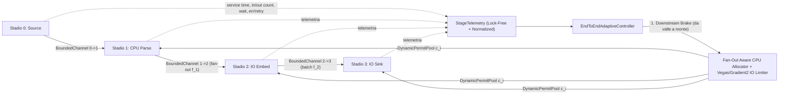

# EazyPipe 2.0 — Piano Strategico e Architetturale: Auto-Bilanciamento End-to-End & Micro-Core

> **Obiettivo**: Trasformare **EazyPipe 2.0** nella micro-libreria Java 21+ di riferimento per **pipeline concorrenti a auto-bilanciamento end-to-end**, eliminando il *bottleneck shifting* e la configurazione manuale dei thread pool, difendendo allo stesso tempo un core ultra-snello, privo di dipendenze e pronto per Maven Central.

---

## 1. Visione Strategica ("Micro-Core, Auto-Bilanciamento End-to-End")

Nell'ecosistema Java moderno (`Java 21+`), la concorrenza di base è sempre più coperta dalla standard library (`Virtual Threads`, `StructuredTaskScope`, `Stream Gatherers` / `Gatherers.mapConcurrent` da Java 24). Una micro-libreria oggi conquista spazio solo se risolve un problema reale che la standard library **non** affronta e che i framework reattivi rendono inutilmente complesso:

> **Pitch di posizionamento**: *"Backpressured, end-to-end auto-balancing concurrent pipelines for Java 21+ Virtual Threads — zero runtime dependencies, zero Reactive complexity."*

### Perché spingere sull'Auto-Bilanciamento End-to-End
1. **Il limite di `Virtual Threads` e `Gatherers.mapConcurrent`**: eseguono task concorrenti, ma non offrono backpressure bounded multi-stadio, batching temporizzato, retry/DLQ per stadio, graceful `drain()`, né tantomeno coordinano il parallelismo tra stadi interdipendenti.
2. **Il limite degli autoscaler locali (es. `concurrency-limits`)**: proteggono un singolo client o endpoint; applicati ingenuamente a una pipeline multi-stadio producono *bottleneck shifting* (uno stadio a monte accelera saturando la coda dello stadio a valle).
3. **Il caso d'uso killer (AI/RAG, ETL, ingestion ad alta varianza)**: pipeline miste `CPU_BOUND` → `flatMap` → `IO_BOUND` (rate-limited / latenza variabile) → `batch` → `Sink` in cui il collo di bottiglia si sposta nel tempo al variare dei payload e della latenza dei servizi esterni.

### Confronto di posizionamento

| Soluzione | Punto di forza | Cosa manca rispetto a EazyPipe 2.0 Target |
| :--- | :--- | :--- |
| **`Stream` / `Gatherers.mapConcurrent`** | Zero dipendenze, ideale su singoli step stateless | Nessuna backpressure tra stadi eterogenei, nessun budget CPU condiviso, nessun `batch(maxSize, maxWait)`, nessun auto-bilanciamento end-to-end |
| **`StructuredTaskScope`** | Eccellente per fan-out / fork-join su task finiti | Non pensato per streaming continuo multi-stadio con code bounded e draining controllato |
| **`Project Reactor` / `Mutiny`** | Ecosistema reattivo completo e maturo | Curva ripida, stack trace complessi, modello non imperativo, parallelismo tipicamente **statico** |
| **`Netflix concurrency-limits`** | Solido AIMD/Vegas su singolo endpoint | Protegge un solo confine I/O; non alloca un budget CPU né frena stadi a monte su backpressure a valle |
| **EazyPipe 2.0 (Target)** | **Codice imperativo bloccante + Virtual Threads + ~133 KB, 0 dep** | **Auto-bilanciamento end-to-end coordinato (CPU + I/O + fan-out aware) con controllo reale di backpressure** |

### Vincoli da "Micro-Libreria"
- **Core ≤ 150 KB**, **zero dipendenze runtime** (`java.base` only), JPMS pulito.
- **Onboarding in 2 minuti**: configurazione di default auto-bilanciante attivabile con una chiamata (`.adaptive()`), senza esporre 15 manopole nell'API di primo livello.
- **Complessità incapsulata**: nessun tipo interno di telemetria o algoritmo esposto nell'API pubblica esportata dal modulo.

---

## 2. Baseline Verificata (`68e7089`) & Debito Tecnico Critico da Chiudere Subito

### Fotografia attuale della codebase
- **Dimensione**: 39 file Java in `src/main/java` (**6.046 LOC**), 8 suite JUnit 5 in `src/test/java` (**1.831 LOC**).
- **Artifatto**: `EazyPipe-2.0.0-SNAPSHOT.jar` (**132.622 byte**, ~133 KB), zero dipendenze runtime, `-Xlint:all -Werror`, `module xyz.scarabya.eazypipe`.
- **Test**: 57/57 verdi con `.\mvnw.cmd -B verify`.
- **Punti solidi già presenti**: API fluente immutabile (`Pipeline<T>`) separata da `PipeExecution<R>` (`AutoCloseable`), lock-based `BoundedChannel` / `DynamicPermitPool` senza pinning di Virtual Threads (`ReentrantLock` + `Condition`), `drain()` vs `cancel()`, `Clock` iniettabile per test deterministici.

### Bug reali e difetti emersi dalla review tecnica (priorità P0/P1)

Prima di costruire la Gen-2 dell'autoscaler o pubblicare `2.0.0`, vanno chiusi i seguenti difetti concreti individuati nel codice:

| # | Componente e Posizione | Problema / Bug Rilevato | Intervento Correttivo |
| :--- | :--- | :--- | :--- |
| **1** | `BoundedChannel.receiveBatch()` (`BoundedChannel.java` L235–L251) | `notFull.signalAll()` viene invocato solo *dopo* il loop `notEmpty.awaitNanos(remaining)`, non subito dopo `drainInto()`. Se il buffer era pieno e `maxSize > bufferCapacity`, il produttore resta bloccato fino a scadenza di `maxWait`, causando stalli artificiali e batch parziali. | Segnalare `notFull.signalAll()` **immediatamente** quando `drainInto()` libera slot (sia prima del loop d'attesa sia a ogni drain intermedio nel loop). |
| **2** | `AdaptiveConfig` (`deadbandLow`/`deadbandHigh`) & `PipeConfig.cpuBudget` | **Parametri morti (silent no-op)**: `deadbandLow`/`deadbandHigh` sono validati ma mai letti; `PipeConfig.cpuBudget` è ignorato da `AdaptiveController` (che legge solo `adaptiveConfig.cpuBudget()`) e non limita i permessi quando l'adaptive è spento. | Unificare `cpuBudget` in una **sola fonte di verità** e applicare il budget CPU globale anche in modalità statica; cablare davvero la deadband nella classificazione con isteresi. |
| **3** | `StageTelemetry.sample()` (`StageTelemetry.java` L127–L128) | `deltaInWait / effectiveWindow` e `deltaOutWait / effectiveWindow` sommano i nanosecondi di attesa di *tutti* i worker concorrenti senza normalizzare per la concorrenza dello stadio → saturazione prematura a `1.0` e falsi positivi `BACKPRESSURED`/`STARVED`. | Normalizzare i wait ratio per il numero medio di worker/permessi attivi nella finestra (`effectiveWindow * Math.max(1, targetConcurrency)`). |
| **4** | `StageTelemetry.sample()` (`StageTelemetry.java` L160–L165) | `baselineServiceNanos = Math.min(baselineServiceNanos, avgService)` è un minimo storico permanente senza decadimento. Un singolo tick anomalo (cache hit, warm-up, payload banale) avvelena per sempre la baseline Vegas, bloccando lo stadio I/O a `minConcurrency`. | Introdurre una **finestra mobile / slow exponential decay** verso l'alto sulla baseline di latenza (es. reset parziale o quantile scorrevole per finestra) così la baseline si adatta ai cambi di regime reali. |
| **5** | `StageScheduler` + `PipelineRuntime` (`ExecutorMode.CUSTOM` & CPU threads) | Per ogni stadio viene allocato e sottomesso subito `maxConcurrency` thread (`CPU_BOUND` crea OS platform thread anche parcheggiati). Con `ExecutorMode.CUSTOM` e un pool fisso (`N < sum(maxConcurrency)`), si verifica **thread-starvation deadlock immediato**. | Eseguire gli stadi `CPU_BOUND` su un pool condiviso dimensionato sul `cpuBudget` effettivo invece di spawnare `maxConcurrency` OS thread per stadio; documentare e validare/prevenire starvation su `ExecutorMode.CUSTOM`. |
| **6** | `CpuBudgetAllocator.allocate()` (`CpuBudgetAllocator.java` L57, L168) | Restituisce `Map<String, Integer>` indicizzata per `stageName`: se due stadi CPU condividono il nome (es. default o duplicati), si sovrascrivono silenziosamente. | Identificare gli stadi per `stageIndex` (o ID univoco interno) e riservare i nomi solo a logging, metriche ed eventi `ScalingDecision`. |
| **7** | `PipelineRuntime` (`tee` e `broadcast`) | `runAuxSinkWorker` usa una `dummyTelemetry` scollegata (rami ausiliari ciechi per metriche e autoscaler); `runBroadcastDispatcher` incrementa `itemsConsumed` al dispatch prima del consumo effettivo e può causare head-of-line blocking sequenziale tra branch. | Integrare telemetria reale dei rami ausiliari negli snapshot, spostare l'incremento di `itemsConsumed` sul completamento dei branch (secondo semantica chiara) e disaccoppiare il dispatch lento tra branch. |
| **8** | `TokenBucketRateLimiter` & `PipeException` su `Error` | `nextFreeNanos = now + intervalNanos` accumula deriva negativa sul rate sotto ritardi di scheduling e non supporta burst da vero token bucket; `PipelineRuntime.wrapFailure` incapsula anche `Error` rendendo morto il check `instanceof Error` in `PipeExecution.propagateFailure`. | Calcolare il refill con `Math.max(now, nextFreeNanos)` (più burst opzionale); allineare la propagazione di `java.lang.Error` lasciandolo emergere non wrappato dove previsto. |

---

## 3. Architettura dell'Auto-Bilanciamento End-to-End Gen-2 (Il Differenziatore)

L'obiettivo della Gen-2 è passare da un autoscaler "stadio-centrico" (che guarda solo le code adiacenti locali) a un **controllore olistico end-to-end della topologia** capace di ragionare sul flusso complessivo della pipeline.

### I 6 Upgrade Chiave dell'Auto-Bilanciamento End-to-End

1. **Allocazione Fan-Out Aware (`filter`, `flatMap`, `batch`)**
   - In una pipeline reale gli stadi non hanno tutti rapporto 1:1: uno stadio `flatMap` può generare $20\times$ item verso valle, un `filter` scartarne il $90\%$, un `batch(100)` comprimerli $100\times$.
   - Ogni stadio traccia il proprio rapporto di espansione EMA $f_i = \frac{\text{emitted}_i}{\text{processed}_i}$ e il controllore calcola il flusso relativo cumulativo $r_i = \prod_{k < i} f_k$.
   - Il `CpuBudgetAllocator` bilancia la capacità effettiva normalizzata sul flusso atteso:
     $$\text{Target: equalizzare } \frac{c_i}{r_i \cdot \hat{s}_i} \quad \text{sotto } \sum_{i \in \text{CPU}} c_i \le C_{\text{budget}}$$
     evitando di sovra-allocare CPU a stadi a monte di un `filter` aggressivo o di affamare uno stadio a valle di un `flatMap` espansivo.

2. **Downstream Propagation Brake (Freno a cascata in un solo tick)**
   - Invece di aspettare che ogni `BoundedChannel` intermedio si saturi uno alla volta per far scattare la backpressure locale, quando uno stadio $k$ risulta `BACKPRESSURED` o saturo verso il sistema esterno, il controllore propaga nello **stesso tick** un segnale di freno verso monte ($j < k$):
     - vieta qualunque scale-up su ogni stadio $j < k$ con canali a valle già sopra soglia di guardia;
     - rilascia rapidamente i permessi CPU/I-O superflui a monte riassegnandoli al vero bottleneck a valle.

3. **Isteresi Reale (Schmitt Trigger) + Deadband Attiva**
   - Cablaggio effettivo di `deadbandLow` e `deadbandHigh` con soglie asimmetriche di entrata/uscita tra `STARVED`, `BALANCED`, `BOTTLENECK` e `BACKPRESSURED`.
   - Aggiunta di una soglia minima di guadagno relativo prima di emettere una variazione di permessi su oscillazioni marginali, eliminando il ping-pong su traffico *bursty*.

4. **Limiter I/O Gen-2 (Vegas / Gradient2 + Retry Signal)**
   - **Baseline mobile**: decay lento/finestra scorrevole della latenza minima $s_i^{\text{base}}$ per non rimanere ancorati a vecchi campioni di cache-hit.
   - **Segnale di saturazione anticipato dai Retry**: tracciamento del tasso di retry per item in `StageTelemetry`. Anche quando un retry riesce (es. HTTP 429 / lock contention transitoria sul DB), indica chiaramente congestione a valle: `IoConcurrencyLimiter` deve frenare prima che i retry si trasformino in failure o dead-letter.
   - **Gradient check**: conferma che allo step-up precedente sia corrisposto un aumento reale di throughput prima di continuare la salita additiva.

5. **Ergonomia "Zero-Config" ("Eazy" nel nome e nell'uso)**
   - **Preset pronti su `AdaptiveConfig`**:
     - `AdaptiveConfig.balanced()` *(default consigliato)*
     - `AdaptiveConfig.throughput()` *(più aggressivo su `BOTTLENECK`, buffer più pieni tollerati)*
     - `AdaptiveConfig.lowLatency()` *(code corte, backoff rapido su code e latenza)*
     - `AdaptiveConfig.disabled()`
   - **Scorciatoie fluenti su `Pipeline<T>`**:
     - `.adaptive()` *(abilita l'auto-bilanciamento end-to-end con preset `balanced()`)*
     - `.adaptive(AdaptiveConfig)` *(senza dover costruire ogni volta un intero `PipeConfig`)*
   - Spostare i parametri avanzati di tuning (`emaAlpha`, `ioLatencyAlpha/Beta`, soglie, deadband) in un blocco secondario `.tuning(...)` lasciando in primo piano solo `cpuBudget`, `tickInterval` e `onDecision`.

6. **Explainable Autoscaling (Osservabilità leggibile in 1 secondo)**
   - Arricchire `ScalingDecision` con la diagnosi sintetica end-to-end: bottleneck dominante individuato, rapporto `latency / baseline`, fattore fan-out $r_i$ e stato dello stadio downstream.
   - Aggiungere un helper compatto `PipelineMetricsSnapshot.summary()` stampabile direttamente nei log applicativi.

---

## 4. Refactor da Micro-Libreria (Pulizia Interna & Superficie JPMS)

Per mantenere la leggibilità e l'agilità di manutenzione di una micro-libreria:

1. **Scomposizione di `PipelineRuntime.java` (1.559 LOC → classi coese ≤ 350 LOC)**:
   - `PipelineOrchestrator` (costruzione topologia, canali, schedulazione task, avvio controller)
   - `StageWorkerLoop` (esecuzione loop per stadio, propagazione contesto e telemetria)
   - `StageExecutionPolicy` (retry, skip, dead-letter, metriche errori)
   - `OrderedReorderBuffer` (estratto in classe package-private dedicata)
   - `LifecycleController` (`drain()`, `cancel()`, `fail()`, `finishStage()`, `finalizeRuntime()`)

2. **Restrizione della superficie pubblica JPMS (`module-info.java`)**:
   - Spostare le classi algoritmiche interne (`AdaptiveController`, `StageTelemetry`, `CpuBudgetAllocator`, `IoConcurrencyLimiter`, `ManagedStage`) in un package **non esportato** (`xyz.scarabya.eazypipe.internal.adaptive`).
   - Lasciare esportati in `xyz.scarabya.eazypipe.adaptive` solo i contratti pubblici di configurazione e osservazione (`AdaptiveConfig`, `StageState`, `ScalingDecision`).
   - I test interni continuano a girare via `--add-opens` / package test dedicati senza vincolare l'API pubblica a implementazioni interne.

3. **Pool CPU condiviso e sicurezza su `ExecutorMode.CUSTOM`**:
   - Eseguire gli stadi `CPU_BOUND` su un pool condiviso di platform daemon thread dimensionato su `cpuBudget` (invece di allocare `maxConcurrency` thread per ogni stadio).
   - Su `ExecutorMode.CUSTOM`, documentare il requisito minimo di thread o eseguire una verifica esplicita se viene fornito un `ThreadPoolExecutor` fisso sottodimensionato rispetto ai worker sottomessi.

4. **Valutazione post-2.0.0: Operator Fusion opzionale**:
   - Stadi stateless consecutivi `map` / `filter` senza `StageConfig` dedicata (nessun `bufferCapacity`, `concurrency`, `retry`, `deadLetter` o `name` custom) possono essere fusi automaticamente nello stesso worker, abbattendo allocazioni di canali e context switch nei casi semplici come `EazyPipe.of(...).filter(...).map(...)`.

---

## 5. Strategia di Proof of Value: Benchmark JMH & 5 Scenari Dimostrativi

L'auto-bilanciamento end-to-end non si vende a parole: va dimostrato con numeri riproducibili e grafici chiari nel repository.

### Isolamento multi-modulo Maven (opzionale, zero impatto sul core)
- `eazypipe-core` — libreria core pura (0 dipendenze runtime, artifact ≤ 150 KB).
- `eazypipe-benchmarks` — suite JMH + simulazioni di carico dinamico con export CSV/grafici (non pubblicata come dipendenza applicativa).
- `eazypipe-micrometer` *(opzionale, separato)* — bridge verso `MeterRegistry` per chi usa Micrometer/Prometheus.

### I 5 Scenari Dimostrativi (Statico vs EazyPipe Adaptive)
1. **Scenario A — *Shifting CPU Bottleneck***: pipeline a 3 stadi `CPU_BOUND` in cui a metà run il carico si sposta da stadio 1 a stadio 3. Confronto: configurazione statica fissa vs `Adaptive` (`CpuBudgetAllocator`).
2. **Scenario B — *Downstream Stall & Anti-Bottleneck-Shifting***: rallentamento improvviso del sink I/O sotto heap limitato (`-Xmx64m`). Verifica: heap piatto, zero OOM, freno a cascata in 1 tick sui permessi a monte.
3. **Scenario C — *External I/O Saturation (Knee + HTTP 429)***: servizio simulato con ginocchio di latenza oltre $K$ chiamate concorrenti e burst di `429` ritentabili. Verifica: convergenza attorno a $K$ tramite segnale combinato latenza + retry.
4. **Scenario D — *AI / RAG Ingestion Eterogenea***: `CPU parse/chunk` → `flatMap` (1→N) → `IO embedding` (rate-limited/retry) → `batch(size, maxWait)` → `IO vector-db`. Dimostra il guadagno combinato dell'allocazione **fan-out aware**.
5. **Scenario E — *Soak & Chaos Test***: flusso continuo ad alta scala (5M–10M item), iniezione di errori transienti e fatali, `drain()` controllato, verifica di zero thread leak e stabilità temporale.

### Benchmark JMH di confronto
Confronto trasparente di throughput, latenza p95/p99 e allocazione per item contro:
- `Stream.parallel()` / `Gatherers.mapConcurrent(...)` (su Java 24+)
- `BlockingQueue` + `ExecutorService` manuale
- `Project Reactor` (`Schedulers.boundedElastic()` / `parallel()`)

---

## 6. Roadmap Esecutiva verso `2.0.0` (Maven Central & Adozione)

### Fase 1 — `v2.0.0-RC1`: Correttezza Core & Telemetria *(Priorità Immediata)*
- [x] Fix `BoundedChannel.receiveBatch()` (`notFull.signalAll()` immediato al drain).
- [x] Unificazione `PipeConfig.cpuBudget` / `AdaptiveConfig.cpuBudget` e applicazione statica del budget CPU.
- [x] Normalizzazione wait ratio e decay/finestra mobile della baseline Vegas in `StageTelemetry`.
- [x] Refactor chiavi `CpuBudgetAllocator` da `stageName` a `stageIndex`/ID univoco.
- [x] Telemetria e semantica corretta per `tee` e `broadcast` (eliminazione `dummyTelemetry`).
- [x] Fix `TokenBucketRateLimiter` (refill privo di deriva + burst) e allineamento propagazione `Error`.
- [x] Pool CPU condiviso dimensionato sul budget + guardia/documentazione `ExecutorMode.CUSTOM`.
- [x] Test di regressione dedicati per ogni bug risolto.

### Fase 2 — `v2.0.0-RC2`: Adaptive Engine Gen-2 & Micro-API
- [x] Stima EMA del fan-out $f_i$ / flusso relativo $r_i$ e `CpuBudgetAllocator` fan-out aware.
- [x] Downstream Propagation Brake in 1 tick da valle a monte.
- [x] Isteresi reale (Schmitt Trigger) + cablaggio effettivo `deadbandLow`/`deadbandHigh`.
- [x] Segnale retry in `IoConcurrencyLimiter` + gradient check.
- [x] Preset `AdaptiveConfig` (`balanced`, `throughput`, `lowLatency`) e `.adaptive()` su `Pipeline<T>`.
- [x] `ScalingDecision` esplicativo + `PipelineMetricsSnapshot.summary()`.
- [x] Scomposizione di `PipelineRuntime.java` e chiusura package interni in `module-info.java`.

### Fase 3 — `v2.0.0-RC3`: Proof of Value & Benchmark
- [x] Creazione modulo `eazypipe-benchmarks` (JMH + 5 scenari dinamici end-to-end).
- [x] Esecuzione test di soak (5M–10M item, `-Xmx64m`) e verifica zero thread/memory leak.
- [x] Pubblicazione di tabelle e grafici reali nel `README.md` (con istruzioni per riprodurli in locale).

### Fase 4 — `v2.0.0`: Release su Maven Central & Lancio
- [ ] Valutazione `artifactId` minuscolo (`eazypipe` vs `EazyPipe`) prima di congelare le coordinate `2.0.0`.
- [ ] Completamento `pom.xml` per Maven Central: `<scm>`, `<developers>`, `maven-source-plugin`, `maven-javadoc-plugin`, firma GPG e publishing plugin.
- [ ] Aggiornamento `README.md` con snippet `<dependency>` Maven/Gradle in cima, 3 esempi copiabili e sezione dedicata all'auto-bilanciamento end-to-end.
- [ ] Tag `v2.0.0` e lancio tecnico mirato (articolo/post su `r/java`, Foojay, Hacker News, dev.to con benchmark reali).

### Definition of Done per il rilascio `2.0.0`
- `eazypipe-core` ≤ **150 KB**, **0 dipendenze runtime**, `module-info.java` minimale senza interni esposti.
- Nessuna classe di produzione > **400 LOC**.
- Tutti i test unitari, di concorrenza e gli scenari A–E verdi in CI (`ubuntu-latest` e `windows-latest`), 0 OOM sotto `-Xmx64m`.
- Su carichi dinamici (Scenari A–D), la modalità `Adaptive` batte nettamente le configurazioni statiche non ottimali e resta entro ≤ 5% di overhead rispetto all'oracolo statico ideale.
- Artefatto firmato e pubblicato su **Maven Central**.
